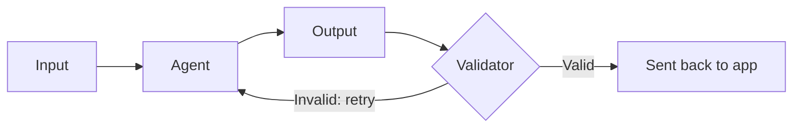

# Bonus Phase — AI Agent

## 1. Goal

Add an AI agent to the editor. The user types a request such as "mark the lines on that window", and the agent creates the anchors, segments, pen paths, and text labels for it on the photo.

## 2. Dependencies

Installed in the server.

| Package | Use |
| --- | --- |
| Vercel AI SDK (`ai`) | Runs the agent: the prompt, the tools, and the retry loop |
| OpenRouter provider (`@openrouter/ai-sdk-provider`) | Connects the agent to a Gemini model through OpenRouter |

## 3. Shared Schemas

- The Zod schemas that validate annotations live in `shared/`, which both the server and the app import.
- Request schemas that only the server needs, such as sign-in, stay in the server.
- The server uses them to validate saved documents and the agent's output.
- The app uses them to validate the agent's annotations before drawing them.

## 4. Agent Workflow

1. The user types a request in the editor. The AI button is off until the document is on the server.
2. The app sends the request, the document id, and the current annotations, including unsaved changes, to the server.
3. The server loads the photo from its own copy, uploaded when the document was created.
4. The system prompt tells the agent what an anchor, a segment, and a pen path are in this app, and the shape of the annotations JSON.
5. The agent returns a `doc.json` with the new annotations to draw.
6. A deterministic check validates `doc.json` against the shared schemas.
   - Invalid: the errors are sent back to the agent, and it tries again, up to 4 retries.
   - Still invalid after 4 retries: the server returns an error and the app shows it.
   - Valid: the server returns the new annotations to the app.
7. The app validates the annotations again, then draws them through the editor's reducer `dispatch`.

## 5. Agent Tools

- No tools for the MVP. The current annotations come with the request and are given to the agent in its prompt.

## 6. After the Agent Draws

- The new annotations are added to the existing ones; nothing is replaced.
- They go through the same reducer as the user's own edits, as one edit, so one Undo removes them all.
- They get new ids in the app, so they can't clash with edits made while the agent worked.
- They use the line color and width the pen tool uses.
- They count as an unsaved change, and Save sends them like any other edit.

## 7. Considered but Not Done

| Option | Why not now |
| --- | --- |
| A dedicated object detection model, such as Grounding DINO or OWLv2, to find the object before drawing | More accurate coordinates, but Gemini is enough for the MVP and a second model is outside the project's scope. |
| Fine-tuning a model on photos with lines the users drew themselves | The model would learn where this app's lines belong, such as the outer frame edge. It needs a labeled dataset and a training setup, which is outside the project's scope. |

## 8. Decision Log

| # | Decision | Why |
| --- | --- | --- |
| 1 | The agent is built with the Vercel AI SDK. | It handles image input, retries, and tool calls, and the model provider can change without rewriting the agent. |
| 2 | The agent uses a Gemini model. | Gemini models are trained to locate objects and return bounding boxes, so they should place points more accurately than models trained mainly to answer questions about an image. Not yet tested. |
| 3 | The agent runs on the server, not on the device. | The OpenRouter API key stays on the server instead of shipping inside the app. |
| 4 | The Zod schemas move from the server to a shared module. | The server and the app validate annotations with the same rules, and the app can check the agent's output before drawing it. |
| 5 | Gemini is reached through OpenRouter, not Google's API directly. | One API key and one provider package; switching to another model is a name change. |
| 6 | The agent is a prompt bar on the canvas page, not a separate tab or a chat modal. | The user sees the lines appear on the photo. The agent answers one request at a time and keeps no conversation, so a chat thread doesn't fit. |
