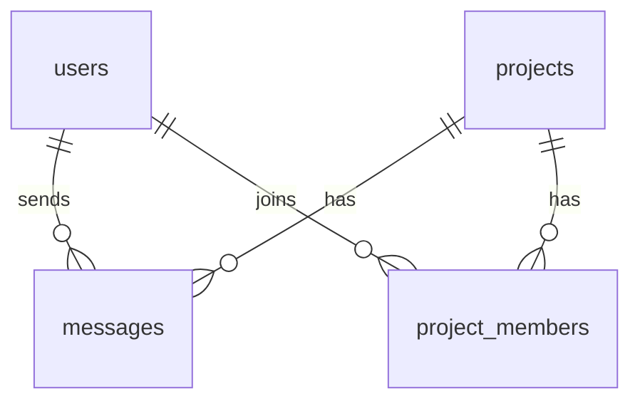

# Bonus Phase — Project Chat

## 1. Goal

Add a chat to each project for its members. Every message belongs to one project and one user. The chat works on the phone and on the web.

## 2. Dependencies

No new packages. Messages are stored in the SQLite database.

## 3. Project Screen

- The project screen has a Chat button that opens the project's chat page.
- Document cards and the canvas page do not change.

## 4. Chat Flow

1. The app loads the project's messages from the server, oldest first.
2. A sent message is saved with the user's id, the project id, and the time.
3. The app fetches messages newer than the last one it has when the page opens, on pull to refresh, with the "Check for new messages" button at the end of the list, and after a send.

## 5. Access

- Only project members, the owner included, can read or send messages.
- A user removed from the project loses access to its chat. Their messages stay.
- Deleting a project deletes its messages.

## 6. DB Model

A new `messages` table.

| Column | Meaning |
| --- | --- |
| `id` | Primary key |
| `project_id` | The project the message belongs to |
| `user_id` | The sender |
| `body` | The message text |
| `created_at` | When it was sent |

## 7. Decision Log

| # | Decision | Why |
| --- | --- | --- |
| 1 | New messages are fetched on request (open, pull to refresh, the check button, a send), with no polling, WebSockets or server-sent events. | The server needs no open connections or timers. |
| 2 | The phone and the web share the same chat screen. | The chat has no canvas or touch-only input, so nothing differs between platforms. |
